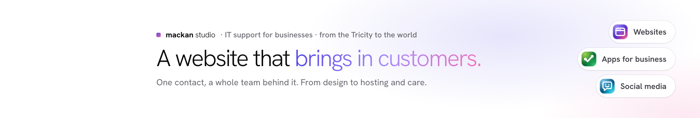

# mackan studio

Websites, social media, online shops and apps for businesses: one contact, a whole team behind it.

| | |
|---|---|
| **Websites** | Fast, readable on a phone and ready for Google. Domain, hosting, SSL and the first year of care included. → [studio.mackan.pl/en/websites](https://studio.mackan.pl/en/websites/) |
| **Social media** | UGC videos by real creators, AI reels from your own photos, and your profile run for you. → [studio.mackan.pl/en/social-media](https://studio.mackan.pl/en/social-media/) |
| **Online shops** | Your own shop on your domain, without a platform subscription, and tools for selling tickets, table bookings, orders and stays. → [studio.mackan.pl/en/shops](https://studio.mackan.pl/en/shops/) |
| **Apps for business** | Your own app, module by module, when the spreadsheet is no longer enough, or automation of what repeats every week. → [studio.mackan.pl/en/apps](https://studio.mackan.pl/en/apps/) |

**Security.** An audit of the website, server, domain and e-mail, also for sites built by someone else. Every care plan includes security updates and vulnerability monitoring.

Run by [Maciej Kankowski](https://maciej.kankowski.pl/) ([@mackankowski](https://github.com/mackankowski)), tech lead with 10+ years of building web applications for international clients. Based in the Tricity (Gdańsk, Gdynia, Sopot), Poland, working in Polish and English.

Client repositories here are private. To talk about a project: maciej@kankowski.pl
